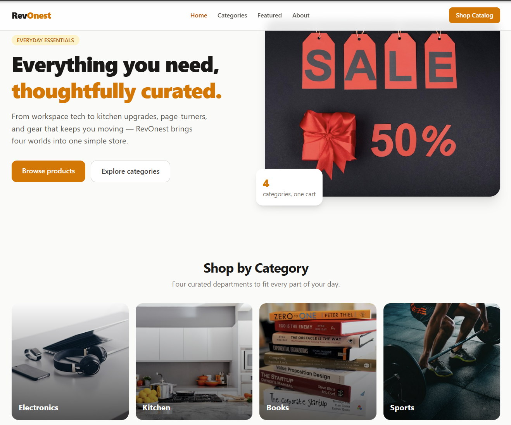
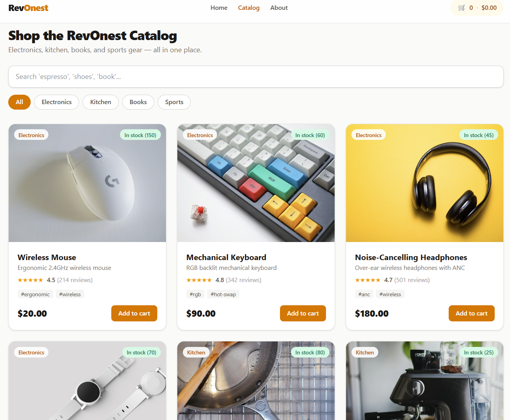
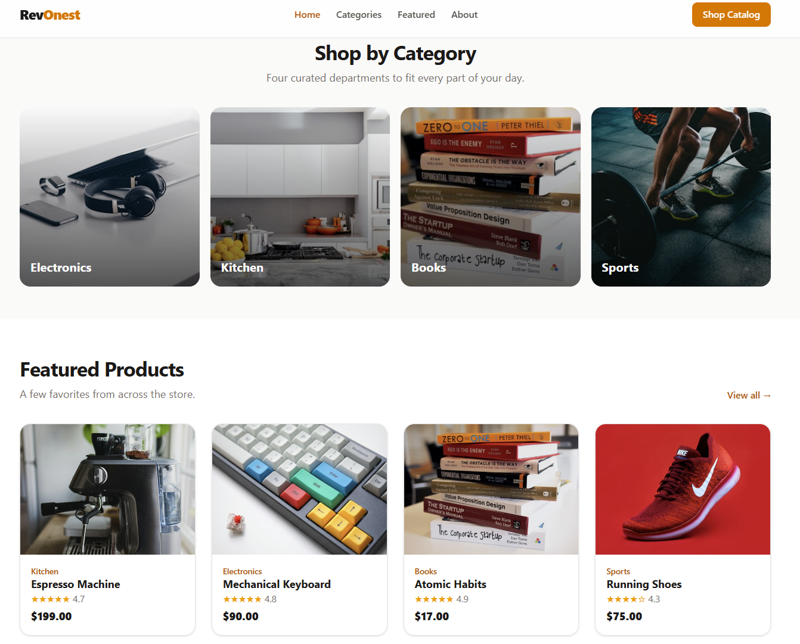
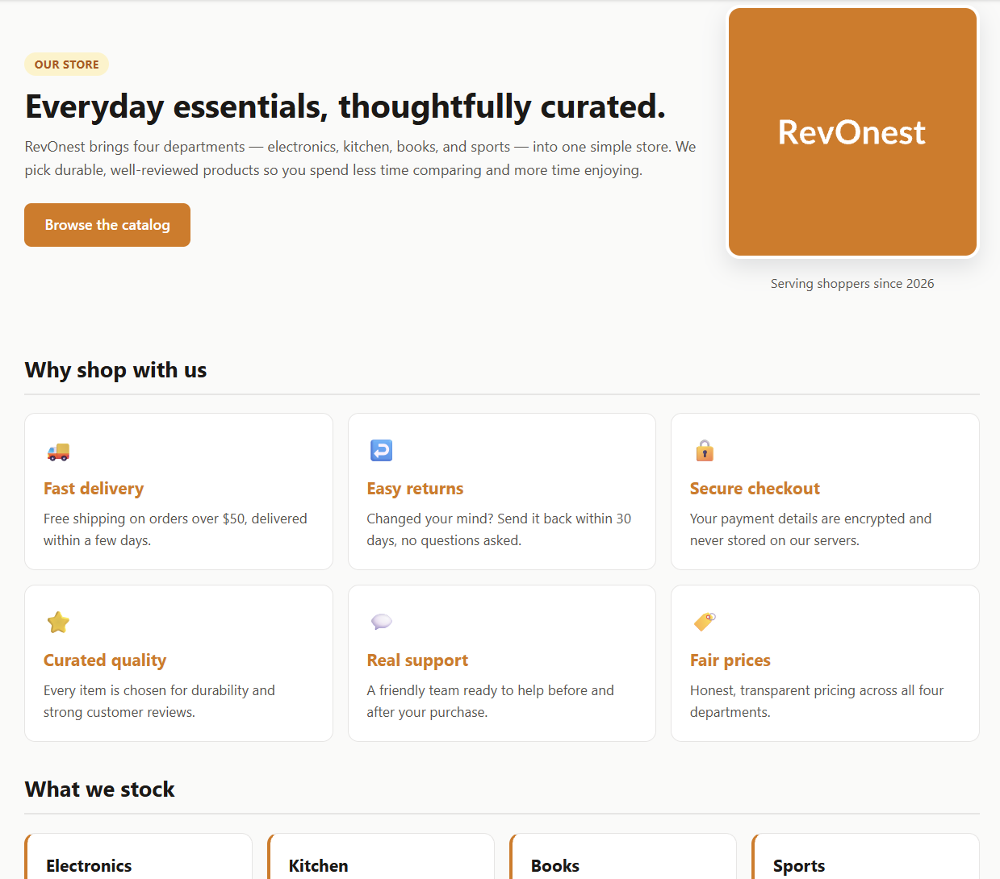

# 🛍️ RevOnest — Frontend Fundamentals (Checkpoint 1)

**RevOnest** is a small demo online store built to practice the raw building
blocks that React, Next.js, and Tailwind sit on top of — **semantic HTML, CSS
layout, vanilla JavaScript, TypeScript, and Tailwind CSS**. It's themed in warm
amber + stone and stocks four departments: **Electronics, Kitchen, Books, and
Sports**.

> This checkpoint is fundamentals-only — it does **not** touch Next.js or the
> Flask API (those come in Checkpoint 2). The typed, interactive catalog here is
> the direct predecessor of the React `ProductCard` built next.

**Built with:** HTML5 · CSS3 (Grid/Flexbox) · Vanilla JavaScript · TypeScript 5 · Tailwind CSS 4

---

## 📑 Table of Contents

1. [What's inside](#-whats-inside)
2. [Quick start](#-quick-start)
3. [Getting started (step by step)](#-getting-started-step-by-step)
4. [Project structure](#-project-structure)
5. [The pages in detail](#-the-pages-in-detail)
6. [Works offline](#-works-offline)
7. [Rebuilding after changes](#-rebuilding-after-changes)
8. [Screenshots](#-screenshots)

---

## 📦 What's inside

| Page | Path | What it is |
| --- | --- | --- |
| 🏠 **Home** | `home/index.html` | Landing page: hero, "shop by category", featured products, promise band. |
| 🛒 **Catalog** | `typescript-tailwind/index.html` | Typed, interactive catalog — live search, category filters, star reviews, stock badges, add-to-cart counter. |
| ℹ️ **About** | `html-css/index.html` | Semantic "About the store" page with a contact form. |
| ⚙️ **JS: DOM & events** | `javascript/dom-events.html` | DOM manipulation + event-handling exercise. |
| 🔢 **JS: array methods** | `javascript/array-methods.html` | `forEach` / `map` / `filter` / `reduce` over the catalog products. |

The pages link to each other, so you can browse the "store" like a real site
(**Home → Catalog → About**). The design is inspired by modern e-commerce
storefronts.

---

## ⚡ Quick start

```bash
# 1. clone the repository
git clone <your-repo-url>
cd Frontend

# 2. open the simple pages directly in a browser (no setup needed)
#    - html-css/index.html      (About)
#    - home/index.html          (Home)
#    - javascript/*.html        (JS exercises)

# 3. the Catalog needs a local server (see step-by-step below)
```

> 💡 The **Catalog** is the only page that needs a local server, because it
> loads compiled JavaScript as an ES module (browsers block modules on
> `file://`). Everything else opens with a double-click.

---

## 🚀 Getting started (step by step)

### Requirements
- A modern browser (Chrome, Edge, or Firefox)
- **Node.js 18+** and **npm** — only needed if you want to *rebuild* the catalog
  (the compiled output is already committed, so you can skip this to just view it)

### Step 1 — Get the code
```bash
git clone <your-repo-url>
cd Frontend
```

### Step 2 — View the simple pages (no tools required)
Open any of these directly (double-click in your file explorer, or right-click →
Open with → your browser):

- `html-css/index.html` — the About page
- `home/index.html` — the store landing page
- `javascript/dom-events.html` — DOM & events exercise
- `javascript/array-methods.html` — array-methods exercise

To check the **responsive breakpoint** on the About page: press `F12`, toggle the
device toolbar (`Ctrl/Cmd + Shift + M`), and choose a phone width (~375px).

### Step 3 — View the Catalog (via a local server)
Pick whichever you have. Run it from the **`Frontend/`** root:

```bash
# Option A — Node (no install beyond npx)
npx serve .

# Option B — Python (usually already installed)
python -m http.server 8000
```

Then open the printed URL and navigate to the catalog, e.g.:

```
http://localhost:8000/typescript-tailwind/index.html
```

> **VS Code users:** install the *Live Server* extension, then right-click
> `typescript-tailwind/index.html` → **Open with Live Server**.

### Step 4 — Try the catalog features
- Type in the **search box** (e.g. `espresso`, `shoes`, `book`) — the list
  filters live.
- Tap a **category chip** (All / Electronics / Kitchen / Books / Sports).
- Click **Add to cart** — the header cart count and total update.

---

## 🗂️ Project structure

```
Frontend/
├── home/                    # Store landing page (compiled Tailwind, offline-ready)
│   ├── src/input.css
│   ├── dist/output.css
│   ├── images/
│   └── index.html
├── html-css/                # Semantic "About the store" page + contact form
│   ├── index.html
│   └── styles.css
├── javascript/              # Vanilla JS exercises (open in the browser)
│   ├── dom-events.html          # DOM manipulation & event handling
│   ├── dom-events.js
│   ├── array-methods.html       # forEach / map / filter / reduce
│   └── array-methods.js
├── typescript-tailwind/     # Typed, interactive product catalog
│   ├── src/
│   │   ├── types.ts             # interfaces, type aliases, union types
│   │   ├── data.ts              # array of typed Product objects (the stock)
│   │   ├── main.ts              # render + live search + filters + add-to-cart
│   │   └── input.css            # Tailwind entry (@import "tailwindcss")
│   ├── images/                  # local product photos
│   ├── dist/                    # compiled JS + output.css (committed)
│   ├── index.html
│   ├── tsconfig.json
│   └── package.json
├── scripts/
│   └── download-images.ps1      # re-download product images (optional)
├── screenshots/
└── README.md
```

---

## 📄 The pages in detail

### 🏠 `home/` — landing page
A hero, "Shop by Category" tiles (Electronics / Kitchen / Books / Sports), a
featured-products grid, and a trust/promise band. Loads a **compiled** Tailwind
stylesheet (`home/dist/output.css`), so it stays styled with no CDN.
**Run:** open `home/index.html` directly.

### ℹ️ `html-css/` — About the store
Semantic HTML5 (`header`, `nav`, `main`, `section`, `article`, `footer`,
`figure`): a hero about the store, a "Why shop with us" grid, category
highlights, and a contact form with associated `<label>`s and appropriate input
types (`text`, `email`, `tel`, `select`, `textarea`).

CSS highlights:
- **Box model** — deliberate margin, border, padding, content
- **Flexbox** — header and hero layouts
- **CSS Grid** — the "Why shop with us" section and the contact form (2-D layout)
- **Responsive breakpoint** — `@media (max-width: 768px)` collapses the grids to
  a single column on mobile

### ⚙️🔢 `javascript/` — vanilla JS exercises
- **`dom-events`** — select/update elements, toggle a class, a click counter,
  create/remove list items, and `click`/`submit` handlers with
  `preventDefault()`.
- **`array-methods`** — `forEach` / `map` / `filter` / `reduce` over the
  **RevOnest catalog products** (sale prices, in-stock items under $100, total
  catalog value, products per department, and a chained `filter → map →
  reduce`). Renders to the page and logs to the console. Also runs under Node:
  `node javascript/array-methods.js`.

### 🛒 `typescript-tailwind/` — typed interactive catalog
The centerpiece. Stock is typed in TypeScript and rendered as Tailwind-styled
cards with images, then made interactive:

- **live search** — filters by name, description, category, or tag
- **category filter chips** — All / Electronics / Kitchen / Books / Sports
- **star reviews** — a star row plus rating and review count per product
- **stock badges** — green "in stock" vs red "out of stock" (out-of-stock
  disables the button)
- **add-to-cart counter** — updates per-product quantity, and the header shows
  total items and total price

TypeScript highlights (`src/types.ts`):
- **interfaces** — `Product`, `ProductMeta`
- **type aliases** — `Category`, `Rating`, `ProductList`, `CartState`
- **union types** — `Category` (literal union) and `Availability`
  (`in-stock` with a quantity **or** `out-of-stock`)
- **nested objects & typed arrays** — `Product.meta`, `Product.tags`,
  `ProductList = Product[]`

Tailwind highlights: utility-first classes, typography utilities, a mobile-first
responsive grid (`grid-cols-1 sm:grid-cols-2 lg:grid-cols-3`), and typed data
mapped to Tailwind class strings (e.g. conditional badge/button colors driven by
the typed `availability` field).

---

## 🔌 Works offline

RevOnest is fully self-contained — every image and stylesheet is committed, so
it renders with **no internet connection**:

- Product images live in `typescript-tailwind/images/`, referenced by local
  paths in `src/data.ts` (e.g. `./images/wireless-mouse.jpg`).
- Home images (hero + category tiles) live in `home/images/`.
- Both the home and catalog pages use **compiled** Tailwind stylesheets instead
  of a CDN.

Images were sourced from [Unsplash](https://unsplash.com) (free to use). To
re-download or swap them (needs internet), run from the `Frontend/` root on
Windows PowerShell:

```powershell
./scripts/download-images.ps1
```

The script maps a descriptive filename to each photo id. To swap an image, edit
the id in the script — or drop your own `.jpg` into the folder using the same
filename.

---

## 🔧 Rebuilding after changes

The compiled output in `dist/` is committed, so viewing needs no build. If you
edit the TypeScript or the markup, rebuild so the output stays in sync:

```bash
cd typescript-tailwind
npm install      # first time only
npm run build    # TypeScript + catalog CSS + home CSS
```

`npm run build` runs three steps:
- `build:ts` — TypeScript → `typescript-tailwind/dist/`
- `build:css` — catalog Tailwind → `typescript-tailwind/dist/output.css`
- `build:home` — home Tailwind → `home/dist/output.css`

During development you can watch instead: `npm run watch:ts` and
`npm run watch:css` (in separate terminals).

---

## 📸 Screenshots

### 🏠 Home


### 🛒 Catalog — live search + Tailwind styling


### 🗂️ Shop by category


### ℹ️ About page


---

<p align="center">© 2026 RevOnest — Checkpoint 1. Built with semantic HTML, CSS, vanilla JS, TypeScript &amp; Tailwind CSS.</p>
