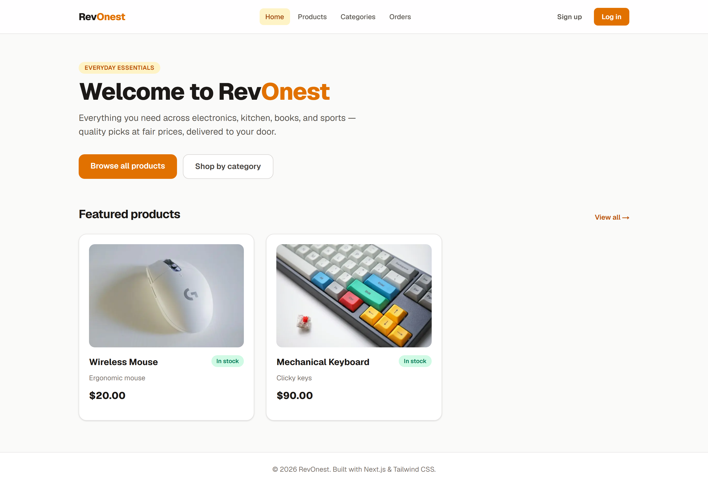
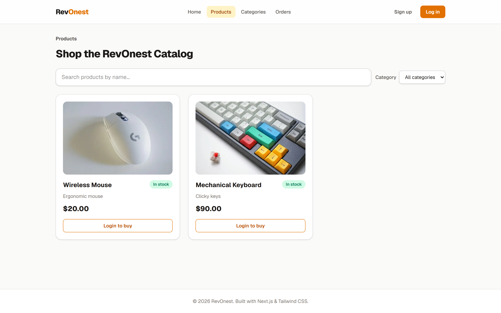
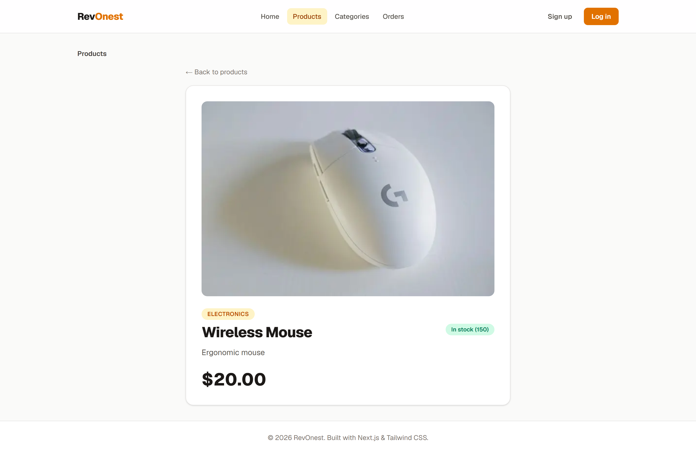
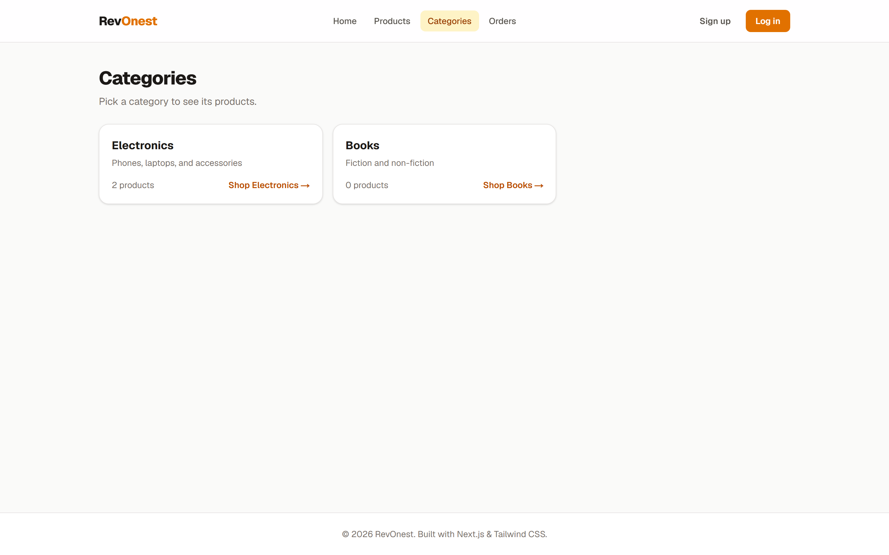
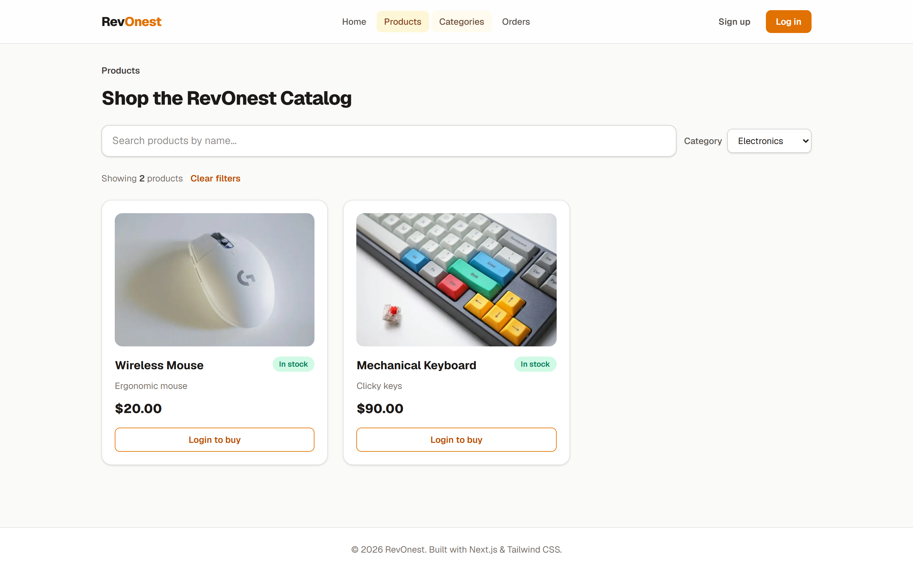
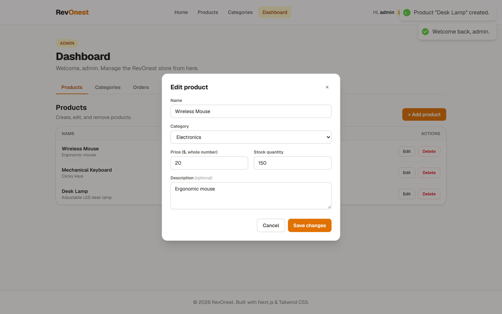
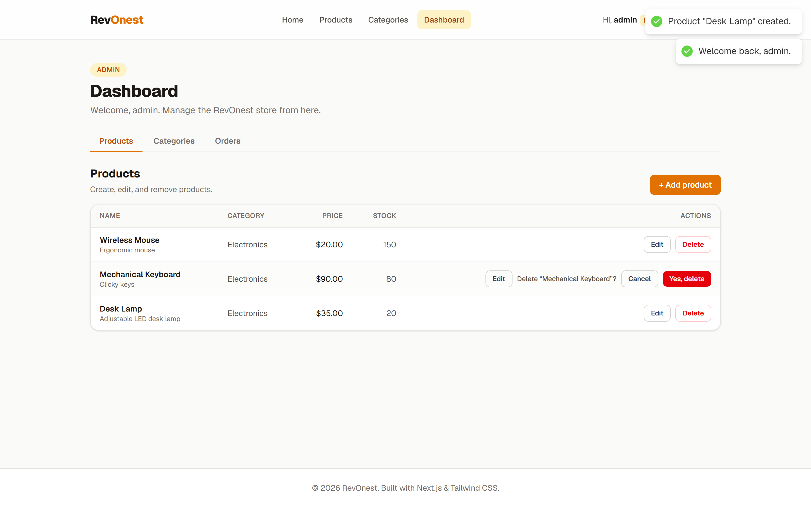
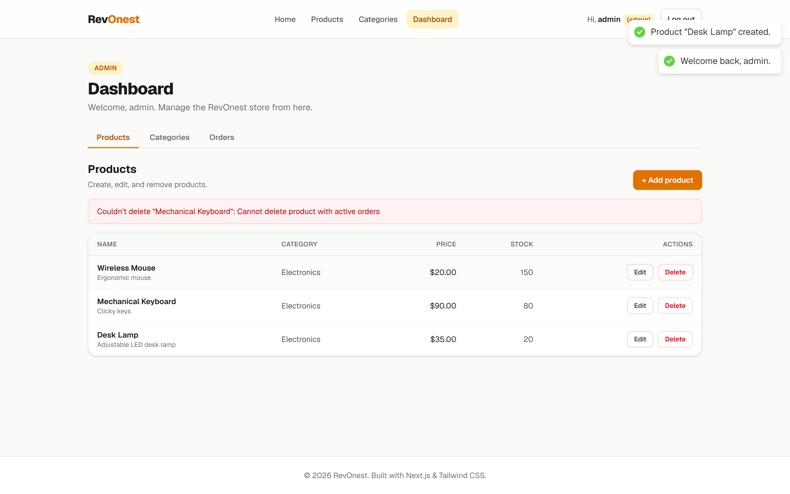
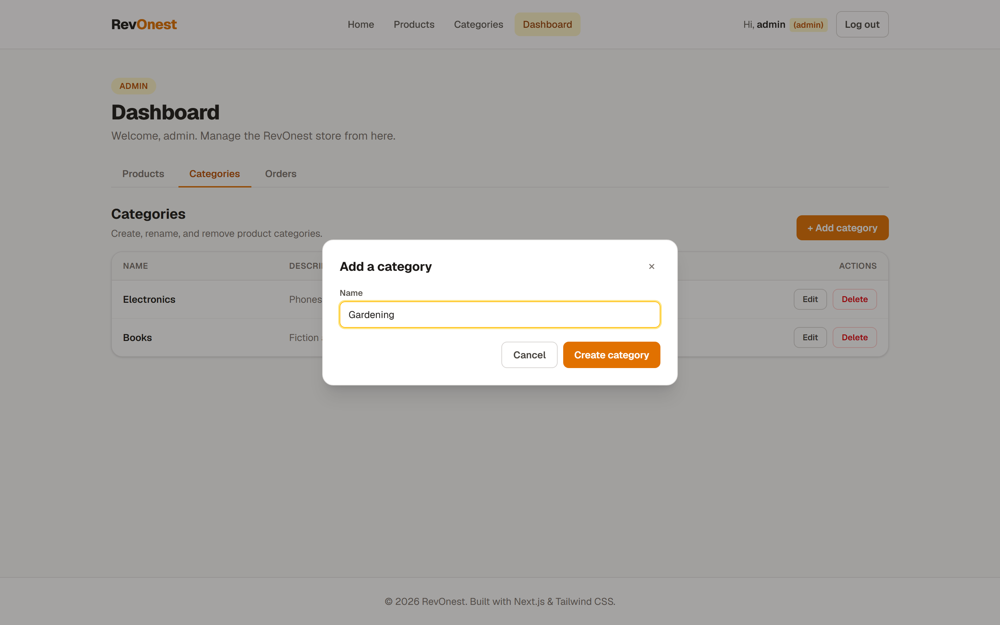
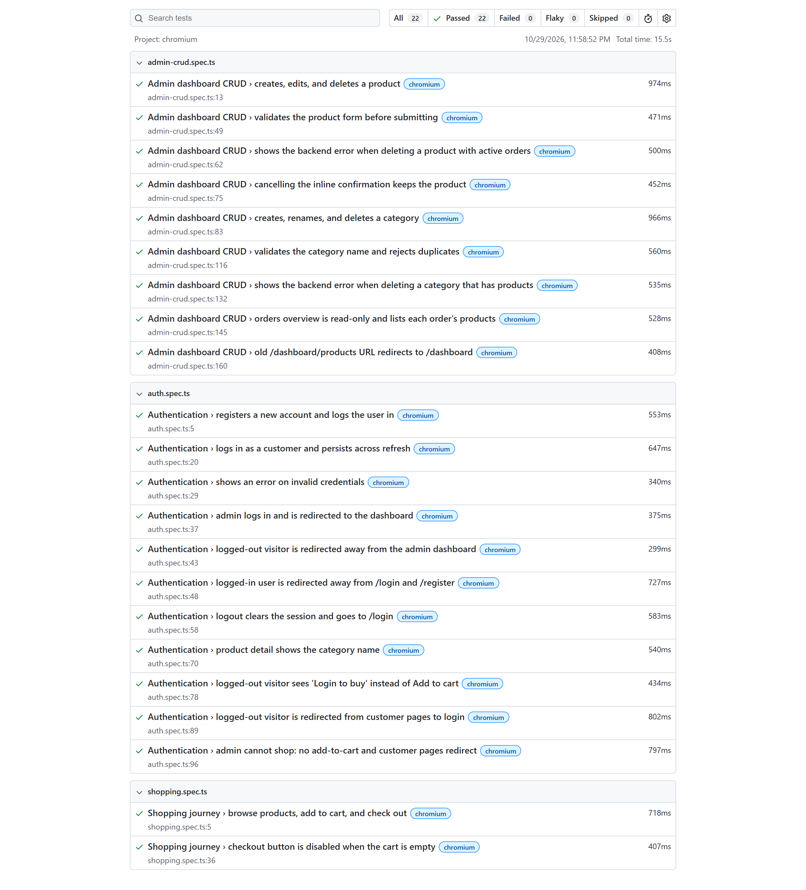

# ▲ RevOnest — Next.js Storefront

RevOnest is the frontend for **RevoShop**, a fictional online store. It is built
with **Next.js 16 (App Router)**, **TypeScript**, and **Tailwind CSS**, and talks
to the **Flask REST API** from the backend module for all of its data.

It serves three kinds of visitors: people browsing while **logged out**,
**customers** who shop and place orders, and **admins** who manage products,
categories, and orders.

**Built with:** Next.js 16 · React 19 · TypeScript 5 · Tailwind CSS 4 ·
react-hot-toast · Playwright · Vercel

## 🔗 Links

| | |
| --- | --- |
| **Live demo (Vercel)** | _Added after deployment_ |
| **Frontend repository** | <https://github.com/muhihsann/RevOnest-Frontend> |
| **Backend API (live)** | <https://revoshop-sgjp.onrender.com> |
| **Backend source (Module 2)** | <https://github.com/Revou-FSSE-Jun26/module-2-muhihsann> |

> The backend runs on Render's free tier and **sleeps when idle**. The first
> request after a quiet period can take about 30 seconds while it wakes up.

---

## 📑 Table of Contents

1. [Overview](#-overview)
2. [Features implemented](#-features-implemented)
3. [Technologies used](#-technologies-used)
4. [Run the project locally](#-run-the-project-locally)
5. [Run the test suite](#-run-the-test-suite)
6. [Environment variables](#-environment-variables)
7. [Routes and access](#-routes-and-access)
8. [Project structure](#-project-structure)
9. [Known limitations](#-known-limitations)
10. [Screenshots](#-screenshots)

---

## 🔭 Overview

RevOnest sells everyday essentials across four categories: electronics, home &
kitchen, books, and sports. Anyone can browse the catalog, search it, and
filter by category. Customers can register, keep a cart that survives page
refreshes, check out, and follow their orders. Admins get a dashboard for
managing the catalog and seeing every order.

Under the hood it mixes **Server Components**, which fetch the first page of
data, with **Client Components** for anything interactive. Every request goes
through a single typed API layer (`lib/api.ts`), whose base URL comes from
`NEXT_PUBLIC_API_BASE_URL`. The logged-in session and each customer's cart are
stored in `localStorage`.

The project was built in three checkpoints in this one repository:

| Checkpoint | Focus |
| --- | --- |
| 1 | HTML, CSS, and JavaScript fundamentals, TypeScript, Tailwind CSS |
| 2 | React components, Next.js App Router, API integration |
| 3 | Forms, authentication, full backend integration, testing |

---

## ✨ Features implemented

### Everyone (logged out)
- **Home** (`/`) with featured products.
- **Product listing** (`/products`) with **live search by name** and a
  **category filter**. They work together, and both are kept in the URL
  (`/products?search=mouse&category=1`), so filtered views can be shared and the
  back button works.
- **Product detail** (`/products/[id]`) showing name, price, stock, and
  category. The browser tab title is the product's name.
- **Categories** (`/categories`): each card shows its product count and opens
  the catalog filtered to that category.
- Product cards show a **Login to buy** link instead of Add to cart.
- **Register** (`/register`) and **login** (`/login`). New accounts are always
  customers. After logging in, admins go to `/dashboard` and customers to `/`.
- `/cart`, `/checkout`, `/orders`, and `/dashboard/*` redirect to `/login`.

### Customers
- **Add to cart** from any product card, with a quantity picker.
- A **cart preview** in the header, and a full **cart page** (`/cart`) with
  quantities, subtotals, the total, a remove button per item, and an empty
  state.
- The cart is **per account** and **survives refreshes** (`localStorage`).
- **Checkout** (`/checkout`) shows the full order summary. The button is
  disabled when the cart is empty. Confirming calls `POST /orders`, clears the
  cart, and goes to `/orders`.
- **My orders** (`/orders`) lists only the logged-in customer's orders. Each
  one opens **order detail** (`/orders/[id]`) with its products, quantities, and
  total. Pending orders can be cancelled.
- Visiting `/login` or `/register` while logged in redirects to `/`.
- **Log out** clears the session and goes to `/login`.
- `/dashboard/*` redirects customers to `/`.

### Admins
Admins manage the store but don't shop, so they have no cart. Product cards
show **Manage in dashboard** instead, and customer pages redirect to
`/dashboard`.

- **Product management** (`/dashboard`): a table of every product with **Edit**
  and **Delete** on each row.
  - **CreateProductForm** opens in a modal and submits to `POST /products`.
  - **EditProductForm** opens in a modal, loads the product from
    `GET /products/[id]`, and submits to `PUT /products/[id]`.
  - **Delete** asks for confirmation inline, then calls `DELETE /products/[id]`.
    If the product has active orders, the backend refuses with a 400 and its
    message is shown.
- **Category management** (`/dashboard/categories`): the same table layout.
  - **CreateCategoryForm** and **EditCategoryForm** have a single name field
    and open in a modal (`POST` / `PUT /categories`).
  - Duplicate names are rejected, and deleting a category that still has
    products shows the backend's error.
- **Orders overview** (`/dashboard/orders`): a **read-only** table of every
  order from every user, with order ID, user ID, the products in the order,
  status, and total.

### Across the app
- **Toast notifications** for success and failure on login, registration, cart
  actions, checkout, and every create, edit, and delete.
- **Loading skeletons** (`loading.tsx`) and **friendly error pages**
  (`error.tsx`) on the data-fetching routes.
- **Product photos** served locally from `public/images`.

---

## 🛠️ Technologies used

| Area | Technology |
| --- | --- |
| Framework | **Next.js 16** (App Router) |
| UI library | **React 19** |
| Language | **TypeScript 5** |
| Styling | **Tailwind CSS 4** |
| Notifications | **react-hot-toast** |
| Routing and navigation | **`next/navigation`** (`useRouter`, `usePathname`, `useSearchParams`, `useParams`) |
| Session and cart persistence | **`localStorage`** |
| API configuration | **`NEXT_PUBLIC_API_BASE_URL`** environment variable |
| End-to-end testing | **Playwright** |
| Deployment | **Vercel** |

---

## 🚀 Run the project locally

**Requirements:** Node.js 18.18 or newer (20+ recommended) and npm.

```bash
# 1. Clone the repository and move into the Next.js app
git clone https://github.com/muhihsann/RevOnest-Frontend.git
cd RevOnest-Frontend/nextjs-revonest

# 2. Install dependencies
npm install

# 3. Create your local environment file
#    (the example already points at the live Flask API)
cp .env.example .env.local        # Windows PowerShell: Copy-Item .env.example .env.local

# 4. Start the dev server
npm run dev
```

Open <http://localhost:3000>. If the first page is slow, the backend is waking
up. Give it a few seconds.

### Demo accounts

| Role | Email | Password |
| --- | --- | --- |
| Admin | `admin@revonest.com` | `Admin123` |
| Customer | `okejohn@email.com` | `Password123` |

You can also register a new customer account at `/register`.

### Production build

```bash
npm run build     # compile and type-check every route
npm run start     # serve the build at http://localhost:3000
```

### Available scripts

| Script | What it does |
| --- | --- |
| `npm run dev` | Start the dev server with hot reload. |
| `npm run build` | Create the production build (also type-checks). |
| `npm run start` | Serve the production build. |
| `npm run lint` | Run ESLint. |
| `npm run test:e2e` | Run the Playwright end-to-end tests. |
| `npm run test:e2e:ui` | Open Playwright's UI to watch and debug tests. |

---

## 🧪 Run the test suite

The end-to-end tests run the real app in a real browser against a **local mock
of the Flask API** (`e2e/mock-server.mjs`). Playwright starts the mock and the
dev server for you. Because every run starts from the same seeded data, the
tests are repeatable, work offline, and never change real data.

```bash
# from nextjs-revonest/

# 1. Install Playwright's browser (first time only)
npx playwright install chromium

# 2. Make sure nothing else is running on port 3000, then run the tests
npm run test:e2e

# Optional: watch the tests in Playwright's UI, or in a visible browser
npm run test:e2e:ui
npx playwright test --headed

# Optional: open the HTML report from the last run
npx playwright show-report
```

A full run reports **22 passed**:

| File | Tests | What it covers |
| --- | --- | --- |
| `e2e/auth.spec.ts` | 11 | Registration and login, session persistence across refresh, invalid credentials, redirects for every role, logout, "Login to buy", admins can't shop, product category |
| `e2e/shopping.spec.ts` | 2 | Products → add to cart → checkout → the order appears in `/orders`; checkout disabled when the cart is empty |
| `e2e/admin-crud.spec.ts` | 9 | Product create, edit, and delete; form validation; delete blocked by active orders; category create, rename, and delete; duplicate names; delete blocked by linked products; read-only orders overview |

> `e2e/screenshots.spec.ts` isn't a test. It regenerates the screenshots in
> this README: `npx playwright test e2e/screenshots.spec.ts`.

---

## 🔑 Environment variables

Copy `.env.example` to `.env.local` and adjust if needed:

| Variable | Purpose |
| --- | --- |
| `NEXT_PUBLIC_API_BASE_URL` | Base URL of the Flask API. Exposed to the browser. |
| `API_SECRET_KEY` | Placeholder for a server-only secret. Not exposed to the browser and not currently used. |

`.env.local` is ignored by git. `.env.example` is committed as a template.

On **Vercel**, set `NEXT_PUBLIC_API_BASE_URL` in the project's environment
variables.

---

## 🧭 Routes and access

| Route | Logged out | Customer | Admin |
| --- | --- | --- | --- |
| `/` | ✅ | ✅ | ✅ |
| `/products`, `/products/[id]` | ✅ | ✅ | ✅ |
| `/categories` | ✅ | ✅ | ✅ |
| `/login`, `/register` | ✅ | → `/` | → `/dashboard` |
| `/cart`, `/checkout` | → `/login` | ✅ | → `/dashboard` |
| `/orders`, `/orders/[id]` | → `/login` | ✅ (own orders only) | → `/dashboard` |
| `/dashboard` (products) | → `/login` | → `/` | ✅ |
| `/dashboard/categories` | → `/login` | → `/` | ✅ |
| `/dashboard/orders` | → `/login` | → `/` | ✅ |

`/dashboard/products` (the old URL) redirects to `/dashboard`.

---

## 🗂️ Project structure

```
nextjs-revonest/
├── app/                      # pages (App Router)
│   ├── layout.tsx            # providers, Header/Footer, toasts
│   ├── page.tsx              # home
│   ├── login/ · register/    # auth pages
│   ├── products/             # listing + [id] detail (+ loading, error, nested layout)
│   ├── categories/           # category listing
│   ├── cart/ · checkout/     # customer cart and checkout
│   ├── orders/               # customer orders + [id] detail
│   └── dashboard/            # admin: products (page.tsx), categories/, orders/
├── components/               # shared UI: Header, Footer, Card, ProductCard,
│   │                         # ProductGrid, ProductList, SearchBar, CategoryFilter,
│   │                         # LoginForm, RegisterForm, CartMenu, Modal,
│   │                         # RouteGuard, GuestOnly, …
│   └── dashboard/            # admin UI: CreateProductForm, EditProductForm,
│                             # CreateCategoryForm, EditCategoryForm,
│                             # InlineConfirmDelete, DashboardShell
├── hooks/                    # useAuth, useCart
├── context/                  # AuthContext (session), CartContext (per-user cart)
├── lib/                      # api.ts (typed fetch), types.ts, filters.ts,
│                             # errors.ts, productImages.ts, toast.ts, ui.ts
├── public/images/            # product photos
├── e2e/                      # Playwright tests + mock API server
├── screenshots/              # images used in this README
├── playwright.config.ts
├── next.config.ts
└── .env.example
```

---

## ⚠️ Known limitations

- **Search and category filtering happen in the browser.** The backend's
  `GET /products` ignores `?search=` and `?category_id=`, so the app fetches the
  products and filters them itself. That's fine for a catalog this size.
- **Roles are checked in the frontend.** The backend has no login tokens, so
  route guards and the "own orders only" rule run in the browser. A real store
  would enforce these on the server too. The one rule the backend does enforce
  is that only pending orders can be cancelled.
- **The backend sleeps when idle** (Render free tier). See the note under
  [Links](#-links).

---

## 📸 Screenshots

Images made by the screenshot script come first. Where I also took my own
screenshot of the same view, it follows.

### Home



### Product listing

Logged out, the cards show **Login to buy**:



Logged in as a customer:


### Product detail



### Categories



Clicking a category opens the filtered catalog:



### Register


### Login


Logged in, the header shows the username and role:


### Cart and checkout

Cart preview in the header:


Cart page:


Checkout:


### My orders


### Admin dashboard

Product management:


Create and edit in a modal:




Inline delete confirmation, and the backend refusing a product with active
orders:




Category management:




Read-only orders overview:


### End-to-end tests

Playwright report, all 22 tests passing:



Running the suite in Playwright's UI mode:


